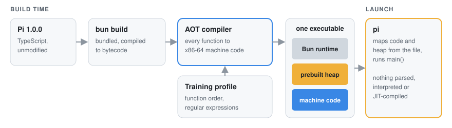

<p align="center">
  <a href="https://github.com/ylstack1/RapidPi">
    
  </a>
</p>

<h1 align="center">Rapid Pi</h1>

<p align="center">
  <b>The <a href="https://github.com/earendil-works/pi">Pi</a> coding agent, compiled ahead of time to native code.</b><br>
  One executable for Linux x86-64 and ARM64, Android (Termux), macOS on Apple silicon and Windows x64.<br>
  No JIT, no Node.js or Bun required.
</p>

<p align="center">
  <a href="https://github.com/ylstack1/RapidPi/actions/workflows/ci.yml"></a>
  <a href="https://github.com/ylstack1/RapidPi/releases/latest"></a>
  <a href="https://www.npmjs.com/package/rapid-pi"></a>
  <a href="https://github.com/ylstack1/RapidPi/stargazers"></a>
  <a href="sources.json"></a>
  <a href="LICENSE"></a>
  <br>
  <a href="#requirements"></a>
  <a href="#requirements"></a>
  <a href="#requirements"></a>
  <a href="#requirements"></a>
  <a href="#android-termux"></a>
  <br>
  <a href="#quick-start"></a>
  <a href="#quick-start"></a>
  <a href="#quick-start"></a>
  <a href="#quick-start"></a>
  <a href="#quick-start"></a>
  <a href="https://aur.archlinux.org/packages/rapid-pi-avx2-bin-release-git"></a>
</p>

<p align="center">
  <a href="#quick-start"><b>Install</b></a> ·
  <a href="#benchmarks"><b>Benchmarks</b></a> ·
  <a href="#documentation"><b>Docs</b></a> ·
  <a href="https://rapid-pi.opensec.in"><b>Website</b></a>
</p>

Rapid Pi is the Pi you already use, with the same commands, sessions, settings, providers and extensions, but every function is
compiled to machine code when the executable is built, so nothing is parsed or JIT-compiled at launch. Against Pi as released on
Node 24, it writes a 400 KB file 120 times faster, uses 8 times less CPU while a long answer streams, 7 times less over a session
and a quarter of the memory; against Pi on stock Bun, much the same.


https://github.com/user-attachments/assets/d043eb7d-ecb2-4837-a3ee-cbd98079adf9

## Why Rapid Pi

| | Pi on Node&nbsp;24 | Pi&#8209;Bolt |
|---|---:|---:|
| Ready to type | 423 ms | **41 ms**<br><sub>10×&nbsp;sooner</sub> |
| Writing a 400 KB file through a tool call | 143.7 s | **1.2 s**<br><sub>120×&nbsp;faster</sub> |
| CPU while a long answer streams | 18.6 s | **2.3 s**<br><sub>8×&nbsp;less</sub> |
| CPU per prompt, 40 prompts into a session | 352 ms | **46 ms**<br><sub>7.7×&nbsp;less</sub> |
| Memory after 40 prompts | 521 MB | **117 MB**<br><sub>4.5×&nbsp;less</sub> |

<sub>Rapid Pi 1.0.0 against Pi 1.4.0 as released, Linux x86-64, one CPU. Every platform: [Benchmarks](#benchmarks).</sub>

- **Nothing to install first:** one executable; no Node.js, Bun or npm to run it.
- **The same Pi:** same commands, sessions, settings and providers; every Pi extension works unchanged.
- **Long sessions stay fast:** a frame costs about the same with 4,000 messages as with none, and typing stays responsive.
- **Everywhere:** Linux x86-64 and ARM64 (Android too, in Termux), macOS on Apple silicon, Windows x64.

## Quick start

**Linux, macOS, Android (Termux)**

```bash
curl -fsSL https://rapid-pi.opensec.in/install.sh | sh
```

**Windows** (PowerShell)

```powershell
irm https://rapid-pi.opensec.in/install.ps1 | iex
```

Or:

- Command Prompt: `powershell -c "irm https://rapid-pi.opensec.in/install.ps1 | iex"`
- Homebrew (macOS on Apple silicon, Linux): `brew install opensec-git/tap/rapid-pi`, updated with `brew upgrade rapid-pi`
- Scoop (Windows): `scoop bucket add opensec-git https://github.com/opensec-git/scoop-bucket`, then
  `scoop install opensec-git/rapid-pi`, updated with `scoop update rapid-pi`
- mise: `github:ylstack1/RapidPi` with the options in the
  [installation guide](https://rapid-pi.opensec.in/docs/installation.html), updated with
  `mise upgrade --bump github:ylstack1/RapidPi`
- npm: `npm install -g --allow-scripts=rapid-pi rapid-pi`
- Bun: `bun add -g --trust rapid-pi`
- Arch Linux: the community AUR package
  [`rapid-pi-avx2-bin-release-git`](https://aur.archlinux.org/packages/rapid-pi-avx2-bin-release-git) (the x86-64 AVX2 build,
  signature checked), `paru -S rapid-pi-avx2-bin-release-git`

Then, in your project:

```bash
rapid-pi                         # start
rapid-pi update                  # install the latest release
rapid-pi update --rollback       # put back the build it replaced
rapid-pi update --channel beta   # take pre-releases too
```

New to Pi? Run `/login` to connect a provider. Your Pi configuration in `~/.pi/agent` is used as is. Rapid Pi installs next to Pi as `rapid-pi`, so both can stay installed;
running the installer again updates, reinstalls or uninstalls it.

<details>
<summary><b>Optional extensions the installer offers</b></summary>

The installer verifies the release signature and offers three optional extensions by OpenSec:

- [`opensec-pi-subagents`](https://www.npmjs.com/package/opensec-pi-subagents): specialized agents in separate sessions,
  parallel workflows and scheduled jobs.
- [`opensec-pi-todo`](https://www.npmjs.com/package/opensec-pi-todo): a todo list for the model, shown as a live panel above the
  editor.
- [`opensec-pi-fff`](https://www.npmjs.com/package/opensec-pi-fff): pi-fff's fast fuzzy find, grep and `@`-mentions, at full
  speed on the default build.

</details>

<details>
<summary><a id="jit-build-for-heavy-plugins"></a><b>JIT build, for heavy plugins</b></summary>

The default build has no JIT: Pi's own code is compiled machine code, and an extension loaded at run time is interpreted. Light
extensions don't notice. For extensions that do heavy work (search, parsing) or use `bun:ffi`, install the JIT build. Pi itself
stays compiled, so it is within about 5% of the default.

```bash
# macOS, Linux ARM64, Termux
curl -fsSL https://rapid-pi.opensec.in/install.sh | RAPIDPI_VARIANT=arm64-jit sh
# Linux x86-64
curl -fsSL https://rapid-pi.opensec.in/install.sh | RAPIDPI_VARIANT=x64-jit sh
```

On Windows, run `$env:RAPIDPI_VARIANT = "x64-jit"` before the PowerShell command. With npm, keep `RAPIDPI_VARIANT` set in your
shell profile; it is read on every run. `rapid-pi --version` then ends in `JIT on`, and `rapid-pi update` keeps the build you
chose.

On the default build, an extension that needs the JIT (it calls into a native library through `bun:ffi`) fails with a line that
names the extension and gives the command that switches to the JIT build.

</details>

<details>
<summary><b>Manual download</b></summary>

Download a build from the [latest release](https://github.com/ylstack1/RapidPi/releases/latest), check it against
`SHA256SUMS`, unpack it and run `./pi` (on Windows, `rapid-pi.exe`).

| Download | For |
|---|---|
| `rapid-pi-linux-x64.tar.xz` | **Linux**, CPUs with AVX2 (Intel Haswell, AMD Zen and later) |
| `rapid-pi-linux-x64-baseline.tar.xz` | Linux, any x86-64 CPU |
| `rapid-pi-linux-arm64.tar.xz` | **Linux** ARM64, any 64-bit ARM CPU (Raspberry Pi 3 and later, AWS Graviton, Ampere) |
| `rapid-pi-darwin-arm64.tar.xz` | **macOS**, Apple silicon |
| `rapid-pi-win32-x64.zip` | **Windows** x64; compiled code on CPUs with AVX2, bytecode on others |

`-jit` builds are for heavy use of plugins loaded at run time; the runtime and kit archives are what `rapid-pi compile` builds
with ([compiling plugins in](docs/PLUGINS.md)). In Termux, use the installer: it sets the executable's loader to Termux's glibc
([Android](#android-termux)).

</details>

<details>
<summary><a id="android-termux"></a><b>Android (Termux)</b></summary>

In [Termux](https://termux.dev) from F-Droid or GitHub (the Google Play version has no glibc packages), run the same
`curl ... | sh` command. Rapid Pi is a glibc program and Android's libc is not glibc, so the installer first installs Termux's
glibc (`pkg install glibc-repo && pkg install glibc`, after asking), sets it as the executable's loader, and links `rapid-pi`
into `$PREFIX/bin`.

`rapid-pi` is a small launcher that starts Rapid Pi in Android's time zone and without Termux's `LD_PRELOAD` (a library of
Android's libc, which glibc cannot load); the programs Rapid Pi starts get it back. The installer copies Termux's `resolv.conf`
and `hosts` to `$PREFIX/glibc/etc`, where Termux's glibc reads them.

</details>

<details>
<summary><a id="requirements"></a><b>Requirements</b></summary>

- **Linux** x86-64 or ARM64 with glibc 2.17 or later (Ubuntu 20.04+, Debian 11+, RHEL/Rocky 8+, Amazon Linux 2, Raspberry Pi
  OS 64-bit). musl is not supported.
- **Android** 7 or later on 64-bit ARM, in Termux.
- **macOS** 13 or later on Apple silicon. Install with the installer, Homebrew, mise or npm
  ([Troubleshooting](docs/TROUBLESHOOTING.md#macos)).
- **Windows** 10 (1809) or later, or Windows 11, on x64. Install with the installer, Scoop, mise or npm; for problems, see
  [Troubleshooting: Windows](docs/TROUBLESHOOTING.md#windows).
- Windows on ARM64 runs the x64 build, in Windows 11's x64 emulation.

</details>

## Features

- **Editors:** `rapid-pi --acp` runs Rapid Pi in the agent panel of Zed, JetBrains IDEs, VS Code, Neovim and other
  [ACP](https://agentclientprotocol.com) editors, with your Pi settings, extensions, skills and sessions. [Setup](docs/ACP.md)
- **Other agents:** `rapid-pi --mcp` is an [MCP](https://modelcontextprotocol.io) server; other agents give Rapid Pi a task with
  its `prompt` tool and continue the session in later calls. [Setup](docs/MCP.md)
- **Built-in search:** the `grep` and `find` tools are on by default and search in-process, following `.gitignore`, with
  nothing to install. With [`opensec-pi-fff`](https://www.npmjs.com/package/opensec-pi-fff) or `@ff-labs/pi-fff` loaded,
  FFF's search tools are used instead. To turn them off (for an extension with search tools of its own), set
  `"defaultTools": ["-grep", "-find"]` in `~/.pi/agent/settings.json`.
- **Compiled plugins:** `rapid-pi compile` compiles the extensions installed on this machine into your Rapid Pi (Linux and macOS)
  with the release's own compiler, where they run as machine code; `rapid-pi update` compiles them into each new release.
  [Plugins](docs/PLUGINS.md)
- **Doctor:** `rapid-pi doctor` prints a plain-text report of your installation to paste into an issue. [Details](#rapid-pi-doctor)
- **Updates:** `rapid-pi update` installs the latest release, and `--rollback` puts back the build it replaced.
- **Herdr:** Rapid Pi shows its state in a [Herdr](https://herdr.dev) pane, and a Herdr restart reopens the conversation.
  [Details](#herdr)
- **ARM64 and Android:** Linux ARM64 builds, and the same installer in Termux. [Android](#android-termux)

Pi extensions work unchanged. The default build has no JIT, so an extension loaded at run time is interpreted; compile the ones
you use every day into Rapid Pi with `rapid-pi compile`, or use the [JIT build](#jit-build-for-heavy-plugins).

<details>
<summary><b>Setup in Zed and Claude Code</b></summary>

In Zed's `settings.json` ([other editors](docs/ACP.md)):

```json
"agent_servers": {
  "Rapid Pi": { "type": "custom", "command": "/full/path/to/rapid-pi", "args": ["--acp"], "env": {} }
}
```

In Claude Code ([other clients](docs/MCP.md)):

```bash
claude mcp add rapid-pi -- /full/path/to/rapid-pi --mcp
```

</details>

<details>
<summary><a id="pi-and-rapid-pi-side-by-side"></a><b>Pi and Rapid Pi side by side</b></summary>

Rapid Pi uses Pi's agent directory (`~/.pi/agent`) and shared `packages` list. Ordinary `rapid-pi install` and `rapid-pi remove`
update that shared list, just as Pi does, and drop Rapid Pi's own entry for that package, so both load what the shared list
declares. Add `--rapid-pi` to change only Rapid Pi's overrides. Using fictional package names:

```bash
rapid-pi install --rapid-pi npm:@example/bolt-tools
rapid-pi remove --rapid-pi npm:@example/shared-tools
```

`rapidPi.packages` extends the shared list. A `-source` entry excludes an inherited package from Rapid Pi without changing Pi;
other shared packages remain inherited. See [Configuration](https://rapid-pi.opensec.in/docs/configuration.html).

```json
{
  "packages": ["npm:@juicesharp/rpiv-todo"],
  "rapidPi": { "packages": ["-npm:@juicesharp/rpiv-todo", "npm:opensec-pi-todo"] }
}
```

</details>

<details>
<summary><a id="rapid-pi-doctor"></a><b>rapid-pi doctor</b></summary>

`rapid-pi doctor` prints a report of your installation, in plain text to paste into an issue: the build and how it was installed,
whether the release's signature verifies, which extensions are compiled in, run at run time or fail to load, how Pi's `packages`
and `rapidPi.packages` differ, the Herdr and editor setup, and the problems it finds, such as another `rapid-pi` earlier on your
`PATH`. It prints no keys or tokens, and shows your home folder as `~`. `rapid-pi doctor --offline` leaves out the release
signature and the check for a newer version.

</details>

<details>
<summary><a id="herdr"></a><b>Herdr</b></summary>

In a [Herdr](https://herdr.dev) pane, Rapid Pi shows up as `rapid-pi` (idle, working or blocked), and a Herdr restart reopens the
same conversation in the same pane. There is nothing to install; `"-builtin:herdr"` in the `extensions` setting turns it off.
Restoring a session needs Herdr 0.9.2 or later. To start other agents in Herdr panes from Rapid Pi, install
[pi-herdr](https://www.npmjs.com/package/@andrewjacop/pi-herdr): `rapid-pi install npm:@andrewjacop/pi-herdr`.

</details>

## Benchmarks

Rapid Pi 1.0.0 against Pi 1.4.0 as released on npm, run by stock Bun 1.4.4 and by Node 24, doing the same work against the same
local model; lower is better.

<details open>
<summary><b>Linux x86-64</b></summary>

| Benchmark | Rapid Pi | Pi on Bun | Pi on Node 24 |
|---|---:|---:|---:|
| Writing a 400 KB file through a tool call, s | **1.2** | 194.8 | 143.7 |
| CPU, streaming a 60,000-character answer, s | **2.34** | 21.92 | 18.62 |
| CPU per prompt, prompts 21 to 40 of a session, ms | **46** | 328 | 352 |
| CPU, interactive session, ms | **167** | 1,087 | 1,180 |
| Memory after 40 prompts, MB | **117** | 309 | 521 |
| Ready to type, ms | **41** | 366 | 423 |

</details>

<details>
<summary><b>Linux ARM64</b></summary>

| Benchmark | Rapid Pi | Pi on Bun | Pi on Node 24 |
|---|---:|---:|---:|
| Writing a 400 KB file through a tool call, s | **1.3** | 164.1 | 134.5 |
| CPU, streaming a 60,000-character answer, s | **2.32** | 18.82 | 18.19 |
| CPU per prompt, prompts 21 to 40 of a session, ms | **42** | 280 | 299 |
| CPU, interactive session, ms | **156** | 1,021 | 1,099 |
| Memory after 40 prompts, MB | **120** | 299 | 640 |
| Ready to type, ms | **37** | 334 | 390 |

</details>

<details>
<summary><b>macOS (Apple M5)</b></summary>

| Benchmark | Rapid Pi | Pi on Bun | Pi on Node 24 |
|---|---:|---:|---:|
| Writing a 400 KB file through a tool call, s | **0.6** | 76.2 | 96.7 |
| CPU, streaming a 60,000-character answer, s | **1.35** | 7.10 | 6.47 |
| CPU per prompt, prompts 21 to 40 of a session, ms | **17** | 111 | 149 |
| CPU, interactive session, ms | **80** | 485 | 523 |
| Memory after 40 prompts, MB | **89** | 746 | 1,363 |
| Ready to type, ms | **24** | 120 | 151 |

</details>

<details>
<summary><b>Windows x64</b></summary>

| Benchmark | Rapid Pi | Pi on Bun | Pi on Node 24 |
|---|---:|---:|---:|
| Writing a 400 KB file through a tool call, s | **1.8** | 131.0 | 110.1 |
| CPU, streaming a 60,000-character answer, s | **2.69** | 44.86 | 39.01 |
| CPU per prompt, prompts 21 to 40 of a session, ms | **53** | 278 | 379 |
| CPU, interactive session, ms | **213** | 1,266 | 1,286 |
| Memory after 40 prompts, MB | **79** | 286 | 378 |
| Ready to type, ms | **78** | 300 | 363 |

</details>

GitHub's runners for Linux (pinned to one CPU) and Windows (2 cores; memory there is the working set); macOS on an Apple M5,
not pinned. Node 22, the method and the raw data: [`bench/results/2026-10-23-stock-bun-1.0.0`](bench/results/2026-10-23-stock-bun-1.0.0).

Against [PiG](https://github.com/MichaelKinsy/PiG) 0.5.1 (Pi ported to Go):
[Rapid Pi against PiG](docs/BENCHMARKS.md#100-against-pig-051-and-099). Every other result, and the method:
[docs/BENCHMARKS.md](docs/BENCHMARKS.md).

## How it works

1. **Bun bundles Pi** and compiles it to JavaScriptCore bytecode.
2. **An ahead-of-time compiler** turns every function into optimized x86-64 or ARM64 machine code, through B3, the back end of
   JavaScriptCore's top-tier JIT.
3. **A prebuilt heap** holds Pi's modules already loaded, and is mapped from the executable at launch.
4. **A training profile** orders the code so that startup touches as few pages as possible.

<details>
<summary><b>Diagram and sources</b></summary>
<br>

<picture>
  <source media="(prefers-color-scheme: dark)" srcset="docs/images/how-it-works-dark.svg">
  
</picture>

The compiler builds on [oven-sh/WebKit#743](https://github.com/oven-sh/WebKit/pull/743). Rapid Pi ports it to x86-64 and macOS
and adds its own code generation and runtime work ([docs/ARCHITECTURE.md](docs/ARCHITECTURE.md)). `packages/` is the Pi release
named in [`sources.json`](sources.json) with Rapid Pi's changes on top; the engine changes are in `patches/`.

</details>

## Documentation

- [Architecture](docs/ARCHITECTURE.md): what the executable contains, how it is built, what happens at launch
- [Building](docs/BUILDING.md): building the runtime and Pi from source, training profiles, tests
- [Benchmarks](docs/BENCHMARKS.md): method, results and raw data
- [Plugins](docs/PLUGINS.md): porting Pi extensions and writing them for AOT
- [Editors](docs/ACP.md): Rapid Pi in Zed, JetBrains IDEs, VS Code and other ACP editors
- [Other agents](docs/MCP.md): Rapid Pi as a tool of other agents and MCP clients
- [Troubleshooting](docs/TROUBLESHOOTING.md): diagnostics, environment variables, known limitations
- [Releasing](docs/RELEASING.md): CI, releases, signing

## Contributing

Bug reports, benchmarks on other hardware and fixes are welcome: see [CONTRIBUTING.md](CONTRIBUTING.md). Report security
issues privately, as described in [SECURITY.md](SECURITY.md).

<details>
<summary><b>Build from source</b></summary>

```bash
git clone https://github.com/ylstack1/RapidPi.git && cd Rapid Pi
scripts/fetch-runtime.sh            # the released Rapid Pi runtime (or build it: docs/BUILDING.md)
scripts/prepare-pi.sh               # builds the Pi in this repository
scripts/build-pi.sh                 # out/rapid-pi/pi
tests/aot/run.sh                    # engine tests
```

</details>

## Star history

<a href="https://www.star-history.com/#opensec-git/rapid-pi&Date">
  <picture>
    <source media="(prefers-color-scheme: dark)" srcset="https://api.star-history.com/svg?repos=opensec-git/rapid-pi&type=Date&theme=dark">
    
  </picture>
</a>

## License

MIT. Release executables include Bun (MIT), JavaScriptCore (LGPL-2.0 and BSD), ICU (Unicode License) and Pi (MIT); see
[THIRD_PARTY_NOTICES.md](THIRD_PARTY_NOTICES.md).

> [!NOTE]
> Rapid Pi is an independent fork of [Pi](https://github.com/earendil-works/pi), not affiliated with Pi's authors or with Oven.

<p align="center">
  Built on <a href="https://github.com/earendil-works/pi">Pi</a> by Mario Zechner and contributors,
  and <a href="https://github.com/oven-sh/bun">Bun</a> by Oven.
</p>
